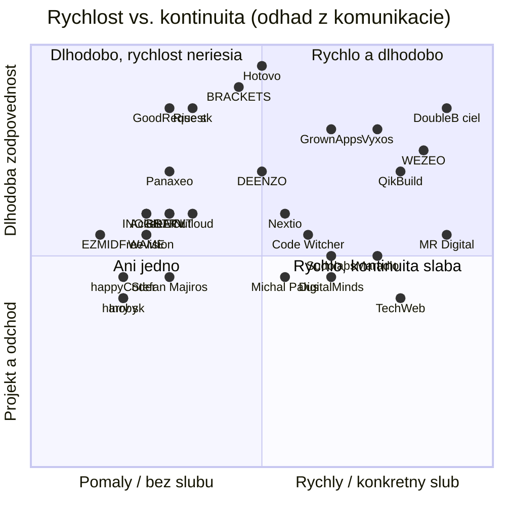

# Analýza konkurencie pre DoubleB dev (Slovensko, november 2026)

Stav k 8. 11. 2026. Weby sme prešli headless prehliadačom (Playwright, Chromium, 1440 × 900). Farby a písma sú vytiahnuté skriptom z vypočítaných štýlov a CSS premenných (`crawl.mjs`, surové dáta v `raw/*.json`). Všetky citácie sú doslovné z uvedených URL. Čo sa nedalo overiť, je označené „nezistené“.

**Doplnok (8. 11. 2026, druhé kolo):** na požiadanie sme pridali Rise.sk a ďalších 9 malých štúdií a freelancerov (riadky 26 až 35). Zoznam teraz obsahuje 35 subjektov. Zhrnutie, vizuálna kolízia a mapa sú prepočítané vrátane nich.

Obmedzenie: priložený obrázok loga v zadaní nebol, takže presný hex našej zelenej nepoznáme. Vizuálnu kolíziu preto porovnávame s „neónovou zelenou na takmer čiernom“ a s modulom z bodiek a paličiek podľa popisu.

---

## 1. Zhrnutie

1. **Rýchlosť už sľubuje veľa firiem, dôkaz takmer nikto.** WEZEO ponúka „demo running in a week“ a MR. Digital „Čo iným trvá mesiac, my dodáme za týždeň.“ Žilinský Vyxos sľubuje „First working result in 1 to 2 weeks“. Konkrétny prípad s dátumom (napríklad naše MVP za 10 dní) nemá na hlavnej stránke nikto. Stavať treba na dôkaze, samotný sľub nestačí.
2. **Rámcová cena do 24 hodín už nie je jedinečná.** Maradlo píše: „Popíšte nám váš projekt a my vám do 24 hodín pošleme detailnú ponuku s cenovou kalkuláciou a harmonogramom.“ QikBuild dáva „orientačnú cenu“ v prvý deň po hovore a Rise.sk má celý cenník verejne („45 €/h + DPH“, „Pilot od 8 000 € + DPH“). Väčšina ostatných je na 48 hodinách. Samotných „24 h“ preto nestačí, rozhodne až to, čo v tej cene klient dostane a kto ju pripraví.
3. **Náš hero má štruktúrneho dvojníka.** MR. Digital píše „Kým ostatní o AI len hovoria, my ju nasadzujeme.“ a „Čo iným trvá mesiac, my dodáme za týždeň.“ Je to rovnaký vzorec „kým iní…, my…“. Navyše cieli na Žilinu cez vlastnú landing page. Riziko, že budeme pôsobiť ako kópia, je stredné až vysoké.
4. **Tmavé pozadie s limetkou je v Žiline obsadené.** GoodRequest (#000000 + #cfe838) a Nextio (#010101 + #d8ff42) majú takmer identickú schému, MR. Digital má limetku #dafe51 ako akcent. Všetky tri limetky majú odtieň 69 až 72°. Ak bude naša zelená žltkastá, zameniteľnosť s GoodRequest je vysoká.
5. **Najbližší priamy konkurent na Slovensku je Rise.sk.** Je takmer rovnako mladý (vznik 4. 6. 2025, FinStat), cieli na rovnaké firmy, má verejný cenník, vlastné produkty a sľub „Viete, s kým na projekte pracujete.“ Vizuálne je tmavý s logom z animovaných štvorcových bodiek. V portfóliu uvádza aj **SmartGym** ako vlastnú referenciu („Platformu sme rozvíjali spolu s tímom SmartGym. Pracovali sme na webe, mobilnej aplikácii a backende.“, január až máj 2026, React a Capacitor). Ak je SmartGym váš projekt alebo klient, overte si, ako ho Rise.sk prezentuje. Detail je v časti 3.
6. **Najbližší priamy konkurent v Žiline je Vyxos, nie GoodRequest.** Je to malá firma (FinStat: 1 zamestnanec, vznik máj 2025), cieli na „companies without their own developer“ a sľubuje prvý výsledok do 1 až 2 týždňov. V logu má raster z bodiek. Zatiaľ je slabý v dôkazoch a komunikuje len po anglicky.
7. **„Hovoríte priamo s tými, čo programujú“ tvrdia hlavne sólisti** (Code Witcher: „Váš projekt riešite priamo so mnou.“, harry.sk). Rise.sk sa k tomu približuje („Viete, s kým na projekte pracujete.“, priame e-maily na CEO a CTO), no má rolu delivery a marketingovej riaditeľky. Väčšie štúdiá predávajú PM vrstvu (BRACKETS: „Every project gets a PM, a designer, and an architect.“). Je to naše najčistejšie biele miesto.
8. **Naša onlyness v súčasnej podobe nie je exkluzívna.** Sólo vývojár v Žiline (harry.sk, prakticky aj Vyxos) tiež „zvládne celý projekt“ a klient „nečaká na niekoho iného“. Exkluzívne je až to, že sme **dvaja zameniteľní**: keď jeden chýba, druhý pozná celý projekt. To netvrdí nikto.
9. **Humor zo seba robí na trhu len TechWeb, a to hlasno a s emoji.** Pokojný, suchý humor (hravosť 4, hlasitosť 2) je voľný. QikBuild je najbližšie („pošleš mi to mailom?“), no stále skôr vecný.

---

## 2. Prehľad trhu

Úplné údaje (služby, dôkazy, farby, písma, tón, zdroje) sú v `competitors.csv`. Tu je skrátená verzia.

| # | Firma | Mesto | Typ | Veľkosť (zdroj) | Hero (doslovne) | Rýchlosť alebo cena na webe |
|---|---|---|---|---|---|---|
| 1 | [GoodRequest](https://www.goodrequest.com/sk) | Žilina + BA | veľká agentúra | „100+ ľudí“ ([o-nas](https://www.goodrequest.com/sk/o-nas)) | „Digitálny partner pre ambiciózne firmy“ | nič; Clutch min. $25k |
| 2 | [BRAIN:IT](https://brainit.com/sk/) | Žilina + BA | veľká agentúra | „80+ in-house expertov“ (hlavná stránka) | „Budúcnosť technológií dnes“ | nič; Clutch min. $10k |
| 3 | [Vyxos](https://vyxos.eu/) | Žilina | malé štúdio | FinStat: 1 zamestnanec ([finstat](https://www.finstat.sk/56908318)) | „We build simple software for a complicated world.“ | „First working result in 1 to 2 weeks“ |
| 4 | [DEENZO](https://deenzo.com/) | Žilina | malé štúdio | „9 Členov tímu“ | „Budujeme značky a digitálne riešenia, ktoré prinášajú výsledky.“ | „Cenová ponuka do 48h“ |
| 5 | [Inoby](https://inoby.sk/) | Žilina | malé štúdio | nezistené | „Chceš posunúť svoj biznis na novú úroveň?“ | nič |
| 6 | [DigitalMinds](https://www.digitalminds.sk/) | Žilina | malé štúdio | „Sme malé štúdio“ | „Tvorba webových stránok v Žiline od 690 €“ | „do 24 h odpoveď“; aplikácie od 4 000 € |
| 7 | [harry.sk](https://www.harry.sk/) | Žilina | freelancer | 1 osoba | „Weby aplikácie a serverové rozhrania“ | nič |
| 8 | [D-Gate](https://www.d-gate.sk/) | Žilina | iné (neaktívny web) | nezistené | bez H1 | nič |
| 9 | [MR. Digital](https://mrdigital.sk/) | B. Bystrica, landing pre Žilinu | veľká agentúra | nezistené („600+ projektov“) | „Digitálne riešenia pre budúcnosť AI agentov“ | „cenovku máte do 48 hodín“ |
| 10 | [Code Witcher](https://codewitcher.sk/) | Prešov | freelancer | 1 osoba voči klientovi | „Weby a aplikácie, ktoré pre vás naozaj pracujú.“ | „Do 24 h odpovieme“; app od 3 000 € |
| 11 | [BRACKETS](https://meetbrackets.com/) | Bratislava | malé štúdio | „20-person“ ([about](https://meetbrackets.com/about)) | „The code is easy. The thinking isn't.“ | „prototype in a day“ |
| 12 | [QikBuild](https://qikbuild.com/sk/) | Bratislava | malé štúdio | 11 mien na [O nás](https://qikbuild.com/sk/about-us) | „Vyvíjame softvér. Nasadzujeme AI. Automatizujeme procesy.“ | orientačná cena 1. deň; 5 až 30+ tis. € |
| 13 | [Freevision](https://www.freevision.sk/) | Bratislava | malé štúdio | „deväť stálych členov“ ([tim](https://www.freevision.sk/tim)) | „Aplikácie pre inovatívne firmy a startupy“ | nič; Clutch min. $50k |
| 14 | [TechWeb](https://techweb.sk/) | Bratislava | malé štúdio | nezistené | „Meníme kávu na váš úspešný p[rojekt]“ | MVP „do mesiaca“; od 8 990 € |
| 15 | [Nextio](https://nextio.sk/) | Bratislava | malé štúdio | „10+ členov v tíme“ | „Vyvíjame aplikácie a IT systémy na mieru“ | nič |
| 16 | [WEZEO](https://www.wezeo.com/) | Bratislava | malé štúdio | Clutch 10–49 | „If the work is slowing you down, leave it to robots and AI“ | „demo running in a week“ |
| 17 | [Outloud](https://outloud.co/) | Bratislava | malé štúdio | Clutch 10–49 | „Custom software and AI for growing companies.“ | nič; Clutch min. $5k |
| 18 | [Panaxeo](https://www.panaxeo.com/) | BA, pobočka Žilina | veľká agentúra | Clutch 50–249 | „We build software for high-stakes domains“ | nič |
| 19 | [Touch4IT](https://www.touch4it.com/) | Bratislava | veľká agentúra | nezistené | „Digital Business Solutions Driving Your Growth“ | nič |
| 20 | [Digital Solutions Studio](https://www.dstudio.software/) | Banská Bystrica | malé štúdio | Clutch 10–49 | „Building products that work“ | fixed price model |
| 21 | [Hotovo](https://www.hotovo.com/) | Košice | veľká agentúra | „130+ engineers“ | „We're a software development team that delivers“ | nič |
| 22 | [Sudolabs](https://sudolabs.com/) | Košice + SF | veľká agentúra | Clutch 50–249 | „Enterprise AI. At startup speed.“ | AI Discovery „4–6 weeks“ |
| 23 | [STRV](https://www.strv.com/) | Praha, Brno | veľká agentúra | „200+ PEOPLE“ | „DIGITAL PRODUCT POWERHOUSE“ | nič |
| 24 | [Applifting](https://applifting.io/) | Praha | veľká agentúra | „200+ People“ | „Lifting your ideas into digital orbit“ | nič |
| 25 | [Ackee](https://www.ackee.cz/) | Praha | veľká agentúra | „70+ lidí v týmu“ | „DĚLÁME APLIKACE A DIGITÁLNÍ PRODUKTY“ | nič |
| 26 | [Rise.sk](https://rise.sk/) | Bratislava | malé štúdio | 9 mien na [/tim](https://rise.sk/tim); FinStat 1 zamestnanec ([finstat](https://www.finstat.sk/56911157)) | „Softvér, ktorý prináša výsledky“ | „45 €/h + DPH“; Pilot „4 AŽ 6 TÝŽDŇOV“ |
| 27 | [EZMID](https://www.ezmid.com/) | Žilina + BA | malé štúdio | FinStat „10-19 zamestnancov“ ([finstat](https://www.finstat.sk/48164887)) | „… AT ITS FINEST“ (animované) | nič |
| 28 | [INOGILE](https://inogile.com/sk) | Lipt. Mikuláš (Clutch) + Praha | malé štúdio | „tím 30 skvelých IT odborníkov“ | „IT riešenia na mieru pre tie najnáročnejšie výzvy“ | nič |
| 29 | [Michal Paluš](https://palus.sk/) | Bratislava | freelancer | 1 osoba | „Staviam MVP do 2 mesiacov.“ | MVP do 2 mesiacov |
| 30 | [Maradlo](https://maradlo.sk/) | nezistené | malé štúdio alebo freelancer | nezistené | „Transformujeme digitálne nápady na skutočnosť“ | ponuka „do 24 hodín“; 2 000 až 15 000+ € |
| 31 | [Stefan Majiros](https://stefan-majiros.com/) | BA + Barcelona | malé štúdio | nezistené | „Progressive 100% custom mobile apps…“ | „Free app estimate“ |
| 32 | [WAME](https://wame.sk/) | Bardejov | malé štúdio | nezistené | „Tvoríme e-shopy a aplikácie, ktoré vám zarábajú peniaze“ | nič |
| 33 | [GrownApps](https://grownapps.io/) | Košice | malé štúdio | Clutch 10–49 | „The tech rescue team for SaaS scaleups.“ | „delivery within weeks“; audit od €5,000 |
| 34 | [happyCoder](https://www.happycoder.sk/) | Poprad | malé štúdio | nezistené | „happyCoder: Váš partner v digitálnom svete.“ | nič |
| 35 | [Matej Chmela](https://www.matejchmela.com/) | nezistené | freelancer | 1 osoba | „Navrhujem a vyvíjam aplikácie na mieru vášmu podnikaniu.“ | nič |

Clutch údaje pochádzajú z [clutch.co/sk/app-developers](https://clutch.co/sk/app-developers) a [clutch.co/profile/wezeo](https://clutch.co/profile/wezeo).

Pozreli sme, ale nezaradili (iné zameranie): Sidera Digital (marketing), Art4web (weby a branding), Webyst (Webflow weby), LoopLabs (web bez obsahu).

Vyradené zo zoznamu: appliable.eu (doména je prázdna), inloopx.com (stránka sa nenačítala do 45 s), mintensive.com (copyright 2011–2018, web neaktuálny), andrejgajdos.com (chyba 502).

---

## 3. Hĺbková analýza (14 najbližších)

### Rise.sk (Bratislava): najbližší priamy konkurent na Slovensku
- **Positioning:** mladé softvérové štúdio pre SME a samosprávy, ktoré predáva istotu a zodpovednosť: interné systémy, automatizáciu dokumentov a modernizáciu starých aplikácií.
- **Silné stránky:** najtransparentnejší cenník na trhu („TECHNICKÁ PRODUKTOVÁ PRÁCA 45 €/h + DPH“, „Pilot od 8 000 € + DPH, 4 AŽ 6 TÝŽDŇOV“, „AI audit od 900 € + DPH, 3 AŽ 4 DNI“). Tváre a priame kontakty na CEO a CTO („Napíšte mi, prejdeme si zadanie a poviem Vám, ako by sme ho postavili.“). Vlastné produkty (MojaFirma, GrantAI, MapaTrhu), ocenenie „Prvé miesto na Inovačnom cirkuse 2026“, porovnávacie podklady („Softvér na mieru vs. hotové SaaS“, „Interný tím vs. externá agentúra“). Veľmi prepracovaný web vrátane ROI kalkulačky a vzoru zadania.
- **Slabé stránky:** rýchlosť nesľubuje („Ako dlho trvá dodanie? Závisí od rozsahu…“), prvá cena prichádza až „po discovery“. Široký záber (marketing, grafika za 35 €/h) riedi profil vývojárov. Web uvádza 9 ľudí, FinStat však kategóriu „1 zamestnanec“, takže časť tímu sú pravdepodobne externisti (odhad, neoverené). Hero je generický („Softvér, ktorý prináša výsledky“).
- **Stack a referencie sa s nami prekrývajú:** prípadová štúdia [SmartGym](https://rise.sk/portfolio/smartgym) uvádza React, TypeScript, Capacitor, GoPay a obdobie „január až máj 2026“, rolu „Platformu sme rozvíjali spolu s tímom SmartGym.“ Klient, ktorý porovnáva nás a Rise.sk, uvidí rovnakú technológiu aj podobný typ projektu.
- **Odlíšenie:** Rise.sk predáva „istotu a poriadok“ s tímom rolí, my rýchlosť a dvoch ľudí, ktorí robia všetko. Konkrétne: cena do 24 h namiesto „po discovery“, prvá verzia do 7 dní namiesto pilotu na 4 až 6 týždňov a Žilina namiesto Bratislavy. Ich verejný cenník je štandard, s ktorým nás klient porovná, preto by sme mali zverejniť aspoň orientačné pásma alebo hodinovku.

### Maradlo
- **Positioning:** malé štúdio pre webové a mobilné appky s pevnými balíkmi pre startupy a SME.
- **Silné stránky:** sľub „do 24 hodín pošleme detailnú ponuku s cenovou kalkuláciou a harmonogramom“, verejné balíky („2 000 - 5 000€“, „Doba realizácie: 2-4 týždne“).
- **Slabé stránky:** šablónovitý text („Transformujeme digitálne nápady na skutočnosť“), sídlo ani tím nie sú na webe uvedené.
- **Odlíšenie:** Maradlo má rovnaký sľub 24 h, ale bez dôkazu a bez tvárí. My môžeme dať k 24 h aj meno toho, kto cenu pripraví a bude programovať, plus reálny prípad.

### EZMID (Žilina)
- **Positioning:** žilinská softvérová firma pre digitalizáciu priemyslu a dopravy.
- **Silné stránky:** FinStat 10 až 19 zamestnancov a výnosy 2025 „1 475 416 €“; silný dôkaz „SHMUDroid … the most popular weather app in Slovakia with 150k+ active users daily“; Hyundai Transys.
- **Slabé stránky:** web je strohý, po anglicky a bez sľubov k cene či rýchlosti. Na malé firmy a startupy necieli.
- **Odlíšenie:** v Žiline sme pre startupy a firmy bez developera, EZMID je pre priemysel. Prekryv vzniká len pri mobilných appkách.

### Michal Paluš (Bratislava)
- **Positioning:** freelancer „Web App Developer & MVP Specialist“ so sľubom MVP do 2 mesiacov.
- **Silné stránky:** známe mená v portfóliu (WizzAir, Hyundai Slovensko, Jägermeister), jasná LEAN filozofia 80/20.
- **Slabé stránky:** 2 mesiace sú pomalšie ako náš týždeň. Na webe uvádza adresu Bosákova 7, rovnakú ako TechWeb s.r.o., a niekoľko rovnakých referencií (IMOoptik, IBOZ, reklamný systém pre leteckú spoločnosť). Pre klienta môže byť nejasné, či kupuje freelancera alebo štúdio.
- **Odlíšenie:** ako sólista nemá zastupiteľnosť. Naše „dvaja, každý zvládne celý projekt“ mieri presne na túto slabinu.

### Vyxos (Žilina): najbližší priamy konkurent
- **Positioning:** malá žilinská firma, ktorá nahrádza zložité systémy a tabuľky jednoduchým softvérom na mieru a sama ho prevádzkuje.
- **Silné stránky:** cieli presne na náš segment („Companies without their own developer who don't want to build a whole IT department“). Pri každej službe má časovú os („First working result in 1 to 2 weeks“). Ponúka aj prevádzku a infra. Má vlastné produkty (Taskwich).
- **Slabé stránky:** web je len po anglicky (prepínač SK je, ale predvolená je EN). Nemá referencie klientov ani čísla. Odpoveď na dopyt sľubuje „within two working days“. FinStat: tržby 2025 sú 13 988 €, firma vznikla v máji 2025.
- **Odlíšenie:** naša odozva je 24 h a jeho dva pracovné dni, my máme pomenované prípady (10 dní, 10+ mesiacov) a sme dvaja zameniteľní, kým on vystupuje ako jedna firma bez tváre. Komunikovať treba po slovensky a s menami ľudí.

### GoodRequest (Žilina)
- **Positioning:** prestížny produktový partner pre veľké značky v každej fáze produktu.
- **Silné stránky:** 100+ ľudí, 12 rokov, Notino, KIA, ocenenia Clutch a Viabona, ISO aj DORA a NIS 2. Silná značka a nábor v Žiline.
- **Slabé stránky:** žiadny sľub rýchlosti ani ceny na webe. Clutch uvádza minimálny projekt $25,000+. Pre malú firmu bez developera pôsobí ako nedostupná („ambiciózne firmy“).
- **Odlíšenie:** sme pre projekty, na ktoré je GoodRequest príliš veľký: cenu poznáte do 24 h a programátor je zároveň váš kontakt. Vizuálne sa od nich musíme zreteľne vzdialiť (pozri časť 4).

### MR. Digital Studio (Banská Bystrica, cieli aj na Žilinu)
- **Positioning:** full-service agentúra s AI v jadre, ktorá sľubuje rýchlosť vďaka AI vývoju.
- **Silné stránky:** veľké čísla (600+ projektov, 4,8★ z 62 recenzií), cenovka do 48 h, landing page „Digitálna agentúra Žilina“.
- **Slabé stránky:** robí všetko (marketing, e-shopy, školenia), takže vývoj produktu je jedna z mnohých služieb. Hlasný tón („PÄŤ ZBRANÍ“, „10× rýchlejší vývoj“). Pobočku v Žiline na webe neuvádza.
- **Odlíšenie:** sme špecialisti na aplikácie a nie full-service agentúra. Hlavne však nesmieme znieť ako oni (vzorec „kým iní…, my…“, pozri časť 6).

### QikBuild (Bratislava)
- **Positioning:** softvér na mieru a AI pre SME, ktoré žijú v Exceli, s fixnou cenou a týždenným demom.
- **Silné stránky:** najtransparentnejší proces na trhu (časová os od „1. DEŇ“ po „+3 MESIACE Opravy chýb zadarmo“) a verejné cenové pásma („5 – 10 tis. €“). Kód patrí klientovi. Ľudský jazyk.
- **Slabé stránky:** má PM aj obchodného poradcu, takže klient nehovorí len s vývojármi. Ide o Bratislavu a klientov v USA. Cenu fixuje až po workshope.
- **Odlíšenie:** sme lokálni v Žiline a klient hovorí len s nami dvoma. Rámcovú cenu dávame do 24 h aj bez workshopu. Ich formát časovej osi a pásiem stojí za to prevziať, slovami aj dôkazmi však vlastnými.

### WEZEO (Bratislava)
- **Positioning:** produktové štúdio pre fintech a MVP, ktoré sa presúva k robotike a AI automatizácii.
- **Silné stránky:** Finax („From MVP to managing €1.06 billion in assets“), silné referencie o dlhodobej spolupráci, sľub „We'll have a demo running in a week.“
- **Slabé stránky:** hero je o robotoch, takže klient hľadajúci aplikáciu sa v ňom nenájde. Web je len po anglicky.
- **Odlíšenie:** „demo do týždňa“ majú ako vetu na konci stránky. My ho môžeme dať do hero s reálnym prípadom.

### BRACKETS (Bratislava)
- **Positioning:** 20-členné produktové štúdio, ktoré predáva premýšľanie pred kódom.
- **Silné stránky:** dobrý hero s pointou, dlhé spolupráce („Our average project tenure is 14 months.“), vlastné SaaS spin-offy, „We replace SaaS where it makes sense“.
- **Slabé stránky:** výslovne sa vymedzuje proti rýchlemu naceňovaniu („Most agencies will happily quote what you wrote down. We'd rather understand it first.“). Clutch uvádza min. $25k.
- **Odlíšenie:** ich výčitka mieri presne na náš hero. Musíme ukázať, že rýchla cena u nás vzniká z porozumenia (krátky hovor, rozsah, rámec) a nie z prepisu zadania. Inak nás klient zaradí k „agencies that happily quote“.

### DigitalMinds (Žilina)
- **Positioning:** malé žilinské štúdio s verejným cenníkom, hlavne WordPress weby, popri tom aplikácie a AI.
- **Silné stránky:** verejné ceny („aplikácie od 4 000 €“), „do 24 h odpoveď“, lokálne referencie (UNIZA).
- **Slabé stránky:** hlavný produkt je web od 690 €, takže aplikácie pôsobia ako doplnok. Má 14 odovzdaných projektov.
- **Odlíšenie:** my sme vývojári aplikácií, nie výrobcovia webov. Pri odozve 24 h musíme rozlišovať „odpoveď“ (oni) a „rámcovú cenu“ (my).

### DEENZO (Žilina)
- **Positioning:** 9-členná agentúra, ktorá spája branding, vývoj a marketing.
- **Silné stránky:** „Cenová ponuka do 48h“, „Dlhodobý partner, nie dodávateľ“, prípadovky s percentami.
- **Slabé stránky:** jadro sú e-shopy na PrestaShope a WordPress weby. Vývoj aplikácií je len v zozname služieb.
- **Odlíšenie:** sme rýchlejší (24 h oproti 48 h) a hlbší v aplikáciách. Ich klienti sú skôr e-commerce.

### Nextio (Bratislava)
- **Positioning:** 10-členné štúdio pre aplikácie a CRM, ktoré sa hlási ako „Rychlejší a overený IT partner“.
- **Silné stránky:** prípady CRM, recenzie 5,0, zmes mobilu a webu.
- **Slabé stránky:** sľub rýchlosti nemá podložený číslom (a štítok je s českým „Rychlejší“). Generický hero „na mieru“.
- **Odlíšenie:** najmä vizuálne. Majú takmer našu schému (čierna + neónová limetka #d8ff42 + pilulkové tlačidlá).

### TechWeb (Bratislava)
- **Positioning:** hravé štúdio pre MVP a webové aplikácie s pevnými MVP balíkmi.
- **Silné stránky:** verejné MVP ceny („8 990 € + DPH“), „funkčné MVP alebo prototyp do mesiaca“, protiagentúrny sľub „bez architekta, analytika, SCRUM-mastera...“.
- **Slabé stránky:** humor je hlučný a plný emoji („Sme digitálni kúzelníci“), čo na B2B klienta môže pôsobiť nevážne. Veľkosť tímu nezistená.
- **Odlíšenie:** ich „bez prostredníkov“ je o rolách, náš o ľuďoch (dvaja konkrétni). Náš humor je tichší a zo seba, ich kúzelnícky.

---

## 4. Vizuálna kolízia

Screenshoty hero sekcií (1440 × 900) sú v `screenshots/` (35 súborov). Pri Freevision zostal cookie banner, ktorý sa nedal zavrieť bez interakcie s formulárom, preto ho necháme tak.

### Zelená, limetka a neón

| Firma | Pozadie hero | Zelená alebo limetka | Odtieň (HSL) | Riziko zámeny s DoubleB |
|---|---|---|---|---|
| GoodRequest | #000000 | #cfe838 (tlačidlo, akcent) | H 69°, S 79 %, L 56 % | **vysoké**: rovnaké mesto, čierna s limetkou, bodkový raster (podľa zadania) |
| Nextio | #010101 / #111111 | #d8ff42 (pilulkové CTA, text „na mieru“) | H 72°, S 100 %, L 63 % | **vysoké**: čierna + neónová limetka + pilulky, rovnaký segment |
| MR. Digital | #ffffff / #f5f2ec | #dafe51 (sekundárny akcent), hlavná je červená #dc2334 | H 72° | **stredné**: svetlé pozadie, ale rovnaká limetka a rovnaký slovný vzorec |
| Panaxeo | #000000 / #f2f2f2 | #16ac8b (veľké plochy) | H 167°, L 38 % | **stredné**: čierna so zelenou, pobočka v Žiline, no tyrkysovo-zelená a nie neón |
| Freevision | #042120 (tmavozelená) | #b3dac0 (mätová) | H 140°, S 35 % | **stredné**: tmavé pozadie s rozhádzanými štvorcovými bodkami, farba je však tlmená |
| harry.sk | #fff5f5 | #bef264 (jedna farebná karta); CSS `--accent: #059669` | H 82° | nízke |
| Vyxos | svetlé (#fafbfc); v CSS aj tmavá téma `--bg: #04050a` | #16794a (drobný detail) | H 152°, L 28 % | **stredné** kvôli logu (pozri ďalej), farbou nízke (zlatá #c9a45a) |
| Applifting | #ffffff | CSS token #73c37c, na hero nepoužitý | H 127° | nízke |
| Rise.sk | #080807 | žiadna (zlatá #dab549, H 45°) | | **stredné**: tmavé pozadie a logo z animovaných štvorcových bodiek, teda podobný princíp „logo z modulov na tmavom“. Farbou sa líši |
| WAME | #ffffff | #1cc869 (veľká zelená vlna) | H 147° | **nízke až stredné**: sýta zelená, ale na bielom s tmavomodrou |
| Michal Paluš | #0b0e18 | žiadna (neónová azúrová #00e5ff, H 186°) | | **nízke až stredné**: tmavé pozadie s neónovým akcentom, iný odtieň |
| ostatní | rôzne | žiadna zelená | | nízke |

Všetky tri limetky, ktoré sa pozerajú na čiernu (GoodRequest, Nextio, MR. Digital), sú v pásme 69 až 72°. **Odporúčanie:** ak chceme zelenú zachovať, posuňme ju do čistej neónovej zelenej okolo 125 až 140° (bez žltej zložky). Tým sa vzdialime od limetiek aj od Panaxeo tyrkysovej (167°). Pozor na WAME #1cc869 (147°): je na bielom pozadí, takže kolízia je malá, ale pri odtieni nad 140° by sa priblížila. Pred zamknutím treba otestovať kontrast textu (WCAG AA) a vedľajší screenshot s GoodRequest.

### Bodky, pilulky a zaoblené moduly

- **GoodRequest:** bodkový raster v pozadí (podľa zadania), limetkové pilulkové tlačidlo. Riziko **vysoké** (bodky + limetka + čierna + Žilina).
- **Rise.sk:** logo (šíp) vykreslené z animovaných štvorcových bodiek na takmer čiernom pozadí, používateľ si môže „Pridať štvorček do animácie“. Riziko **stredné až vysoké** pre princíp modulu: priamy konkurent s takmer rovnakým pozadím a logom z bodiek. Odlišuje ich zlatá farba a pätkové písmo.
- **Vyxos:** logo „V“ poskladané z rastra štvorcových bodiek v zlatej. Riziko **stredné**: iný tvar (štvorce, nie bodky s paličkami) aj iná farba, ale rovnaká myšlienka „logo z modulov“ v rovnakom meste a segmente.
- **Freevision:** rozhádzané štvorcové bodky na tmavozelenom pozadí hero. Riziko **stredné až nízke**.
- **BRAIN:IT:** logo s malými štvorcami vedľa „3“. Riziko **nízke**.
- **Ackee:** pixelová 3D ilustrácia. Riziko **nízke** (iná farba, iná krajina).
- **Pilulky:** Nextio (limetková pilulka CTA), BRACKETS (jantárová pilulka okolo slova „thinking“), MR. Digital (červené pilulkové štítky). Pilulkový tvar je bežný, kolízia vzniká až v kombinácii s limetkou na čiernej (Nextio).

**Záver:** samotný modul z bodiek a paličiek je zatiaľ originálny, no „logo z bodiek na tmavom“ už majú Rise.sk aj Vyxos. Kolízia vzniká kombináciou „tmavé pozadie + žltozelená + bodky“, ktorú má GoodRequest. Odporúčame zmeniť odtieň zelenej a pri logu zdôrazniť paličky (tie nemá nikto), nie samotné bodky. Animované logo z častíc ako Rise.sk nepoužívať.

### Písma

Pätkové nadpisy majú GoodRequest (tiempos) a Panaxeo (new-spirit). Najčastejšie bezpätkové sú Inter (GoodRequest, DEENZO, DigitalMinds, Vyxos, QikBuild) a Plus Jakarta Sans (DigitalMinds, harry.sk, TechWeb). Ak budeme chcieť byť rozpoznateľní, vyhnime sa Interu v nadpisoch.

---

## 5. Analýza textov

### Najčastejšie pojmy v hero a podnadpisoch (25 firiem, skript `textstats.mjs`)

| Pojem | Výskyty | Firiem |
|---|---|---|
| digitálny / digital | 16 | 11 |
| firmy / companies / business | 13 | 10 |
| produkt / product | 10 | 8 |
| softvér / software | 9 | 8 |
| aplikácie / apps | 9 | 8 |
| AI | 9 | 7 |
| riešenia / solutions | 8 | 6 |
| na mieru / custom | 5 | 5 |
| partner | 4 | 3 |
| budúcnosť / future | 3 | 3 |
| inovácie / innovative | 3 | 3 |
| rýchlosť / speed | 2 | 2 |

Na celej hlavnej stránke sa „partner“ objavuje u 15 z 25 firiem, „na mieru“ u 12 a „custom“ u 13. „Digitálne riešenia“ a „partner“ sú v tomto segmente prázdne slová. Slovo „rýchly“ v hero má len Sudolabs („At startup speed“) a Nextio („Rychlejší“).

### Vzorce typické pre texty od AI

Počty sú z celej hlavnej stránky. Trojčlenné zoznamy sú hrubý odhad regulárnym výrazom (vzor „A, B a C“).

| Firma | Dlhé pomlčky „—“ | Trojčlenné zoznamy (odhad) | Príklad |
|---|---|---|---|
| MR. Digital | 26 | 25 | „Vývoj, marketing, rýchlosť aj vizuál na nej stavajú — preto dodávame rýchlejšie a lacnejšie…“ |
| Sudolabs | 12 | 9 | „Two parallel streams — technical feasibility and strategic assessment — converge…“ |
| GoodRequest | 8 | 15 | citácie klientov s pomlčkou „—“ |
| WEZEO | 3 | 34 | najviac výpočtov na stránke |
| DigitalMinds | 0 | 22 | zoznamy služieb |
| QikBuild | 0 | 15 | hero „Vyvíjame softvér. Nasadzujeme AI. Automatizujeme procesy.“ (trojica ako hlavný motív) |
| Code Witcher | 3 | 15 | hero podnadpis s tromi vetami „Konfigurátory… Systémy… A firemné weby…“ |

Vzorec „nie X, ale Y“ (alebo „X, not Y“):
- DEENZO: „Dlhodobý partner, nie dodávateľ“, „Nie sme len ďalšia digitálna agentúra“, „podľa vašich potrieb, nie podľa módnych trendov“ ([deenzo.com](https://deenzo.com/))
- Vyxos: „serves for years, not months“, „Delivery is where our work starts, not where it ends“, „built around your process, not a customized template“ ([vyxos.eu](https://vyxos.eu/))
- BRACKETS: „We staff teams, not seats.“, „Long-term partnerships, not project-and-run.“ ([approach](https://meetbrackets.com/approach))
- MR. Digital: „Výsledky, nie sľuby.“ ([mrdigital.sk](https://mrdigital.sk/))
- harry.sk: „voľba vždy vychádza z kontextu, nie zo šablóny“ ([harry.sk](https://www.harry.sk/))

Bez týchto vzorcov (alebo len okrajovo) sú BRACKETS na hlavnej stránke, D-Gate, TechWeb a Nextio.

### Kto už sľubuje to, čo my

**Rýchlosť a prvá verzia do X dní**
- WEZEO: „Got an idea? We'll have a demo running in a week.“ ([wezeo.com](https://www.wezeo.com/))
- MR. Digital: „Čo iným trvá mesiac, my dodáme za týždeň.“ ([mrdigital.sk](https://mrdigital.sk/))
- Vyxos: „First working result in 1 to 2 weeks“ ([vyxos.eu](https://vyxos.eu/))
- BRACKETS: „AI changed the math: we can build a prototype in a day.“ ([meetbrackets.com](https://meetbrackets.com/))
- TechWeb: „funkčné MVP alebo prototyp do mesiaca“ ([techweb.sk](https://techweb.sk/))
- QikBuild: „Každý týždeň funkčné demo.“ ([qikbuild.com/sk](https://qikbuild.com/sk/))
- Hotovo: „You need an MVP quickly“ ([hotovo.com](https://www.hotovo.com/))
- Michal Paluš: „Staviam MVP do 2 mesiacov.“ ([palus.sk](https://palus.sk/))
- Maradlo: „Doba realizácie: 2-4 týždne“ pri základnom balíku ([maradlo.sk](https://maradlo.sk/))
- GrownApps: „Consultation within days, delivery within weeks.“ ([grownapps.io](https://grownapps.io/))
- Rise.sk: „Pilot od 8 000 € + DPH, 4 AŽ 6 TÝŽDŇOV“ ([cennik](https://rise.sk/cennik))

**Rýchla cenová ponuka**
- Maradlo: „Popíšte nám váš projekt a my vám do 24 hodín pošleme detailnú ponuku s cenovou kalkuláciou a harmonogramom.“ ([maradlo.sk](https://maradlo.sk/))
- QikBuild: „1. DEŇ 30-minútový hovor. Dozviete sa, čo by sme postavili ako prvé, aj orientačnú cenu.“ ([qikbuild.com/sk](https://qikbuild.com/sk/))
- Rise.sk: verejný cenník („45 €/h + DPH“) a „Pred začiatkom dostanete odhad rozsahu, riziká, predpoklady a to, ako budeme fakturovať.“ ([cennik](https://rise.sk/cennik))
- MR. Digital: „nezáväznú cenovku máte do 48 hodín“ ([mrdigital.sk](https://mrdigital.sk/))
- DEENZO: „Cenová ponuka do 48h“ ([kontakt](https://deenzo.com/kontakt.html))
- TechWeb: predbežná ponuka „do 48 hodín“ po úvodnom hovore ([mvp-vyvoj-cena-slovensko](https://techweb.sk/mvp-vyvoj-cena-slovensko))
- DigitalMinds a Code Witcher sľubujú „odpoveď do 24 h“, nie cenu ([digitalminds.sk](https://www.digitalminds.sk/), [codewitcher.sk](https://codewitcher.sk/))

**Malý tím a priamy kontakt**
- Code Witcher: „Váš projekt riešite priamo so mnou. Som Tomáš Milý.“ ([codewitcher.sk](https://codewitcher.sk/))
- harry.sk: „Volám sa Peter. Dvadsať rokov sa venujem webovým technológiám…“ ([harry.sk](https://www.harry.sk/))
- Rise.sk: „Viete, s kým na projekte pracujete.“ a „Klient vždy vie, kto zodpovedá za ďalší krok.“ ([o-nas](https://rise.sk/o-nas)); na [kontakte](https://rise.sk/kontakt) priame e-maily a telefóny na CEO a CTO
- TechWeb: „bez architekta, analytika, SCRUM-mastera...“ ([techweb.sk](https://techweb.sk/))
- Opačný prístup má BRACKETS: „Every project gets a PM, a designer, and an architect.“ ([approach](https://meetbrackets.com/approach))

**Dlhodobá spolupráca**
- Hotovo: „Average length of cooperation 6 years“, „Our longest partnership 15 years“ ([hotovo.com](https://www.hotovo.com/))
- BRACKETS: „Our average project tenure is 14 months.“, „Most of our clients have been with us for 3+ years.“ ([approach](https://meetbrackets.com/approach))
- DEENZO: „Naša zodpovednosť nezaniká odovzdaním projektu.“ ([deenzo.com](https://deenzo.com/))
- Vyxos: „We look after every system we have launched“ ([vyxos.eu](https://vyxos.eu/))
- Rise.sk: „Hľadáte tím, ktorý zostane pri projekte?“ a „Softvér, za ktorý ručíme“ ([o-nas](https://rise.sk/o-nas))
- GrownApps: „Stays for the long haul (Rockpoint: 9+ years)“ ([grownapps.io](https://grownapps.io/))

**Náhrada agentúry alebo SaaS**
- BRACKETS: „We replace SaaS where it makes sense“ ([approach](https://meetbrackets.com/approach))
- QikBuild (citácia klienta): „Náš zákaznícky portál sme skúšali postaviť s niekoľkými klasickými vývojárskymi agentúrami.“ ([qikbuild.com/sk](https://qikbuild.com/sk/))
- Vyxos: „Lower monthly costs than a bundle of licenses you won't fully use“ ([vyxos.eu](https://vyxos.eu/))
- Rise.sk: porovnanie „Softvér na mieru vs. hotové SaaS“ a „Interný tím vs. externá agentúra“ ([porovnanie](https://rise.sk/porovnanie))
- GrownApps: „rescuing failed projects“, teda prevzatie projektu po inom dodávateľovi ([grownapps.io](https://grownapps.io/))

---

## 6. Test nášho positioningu

### Hero „Kým iní ešte naceňujú, my už vyvíjame.“

- **Doslovnú zhodu sme nenašli** ani na 25 weboch, ani vo webovom vyhľadávaní frázy „kým iní“.
- **Štruktúrnu zhodu áno:** MR. Digital píše „Kým ostatní o AI len hovoria, my ju nasadzujeme.“ a „Čo iným trvá mesiac, my dodáme za týždeň.“ ([mrdigital.sk](https://mrdigital.sk/)). Je to ten istý rétorický vzorec „oni pomaly, my rýchlo“. MR. Digital cieli na Žilinu landing stránkou ([digitalna-agentura-zilina](https://mrdigital.sk/digitalna-agentura-zilina)).
- **Myšlienkový protipól:** BRACKETS útočí presne na rýchle naceňovanie („Most agencies will happily quote what you wrote down. We'd rather understand it first.“).
- **Riziko pre tón:** veta sa porovnáva s inými. Náš hlas má mať humor „zo seba, nikdy na úkor iných“. „Kým iní ešte naceňujú“ je jemná výčitka iným, teda na hranici tohto pravidla.
- **Odporúčanie:** hero ponechať, ak podnadpis hneď dodá dôkaz (napríklad „Rámcová cena do 24 hodín. Prvá verzia do 7 dní.“) a odkaz na prípad. Ako záložnú variantu otestovať formuláciu bez „iných“, napríklad v tvare „Cenu máte zajtra. Prvú verziu o týždeň.“ Túto otázku tónu musí rozhodnúť zakladateľ.

### Onlyness „jediné vývojárske štúdio v Žiline, kde každý rozumie produktu aj kódu a každý zvládne celý projekt, takže klient nikdy nečaká na niekoho iného“

| Kto v Žiline | Platí to aj pre neho? | Prečo |
|---|---|---|
| harry.sk | čiastočne áno | sólo vývojár rieši celý projekt sám a nikoho iného niet. Nie je však „štúdio“ a o produkte nehovorí |
| Vyxos | čiastočne áno | FinStat uvádza 1 zamestnanca a vlastné produkty (Taskwich), takže „produkt aj kód“ sedí. Ak je to jeden človek, klient nemá na koho iného čakať |
| DigitalMinds | nezistené | „malé štúdio“ bez mien, rolu ľudí web neuvádza |
| DEENZO | nie | 9 ľudí, delenie na dizajn, vývoj a marketing |
| EZMID | nie | 10 až 19 zamestnancov (FinStat), firma pre priemysel |
| GoodRequest, BRAIN:IT, Panaxeo | nie | veľké tímy so špecializovanými rolami |

Mimo Žiliny sa onlyness najviac približuje Rise.sk („Viete, s kým na projekte pracujete.“), no tam má každý inú rolu (CEO, CTO, marketing), takže „každý zvládne celý projekt“ netvrdia.

**Záver:** v Žiline je onlyness pravdivá len voči štúdiám s viac ako jedným človekom. Voči sólistom nie je exkluzívna. Exkluzívne je až to, čo sólo nemá: **dvaja ľudia, každý pozná celý projekt, takže výpadok jedného nezastaví prácu**. Navrhujeme pracovnú úpravu: „Jediné vývojárske štúdio v Žiline, kde sú obaja ľudia zameniteľní: každý pozná produkt aj kód celého projektu, takže práca nestojí, ani keď jeden chýba.“

Upozornenie: slovo „jediné“ v reklame je porovnávacie tvrdenie, ktoré by sme mali vedieť doložiť. Interne je v poriadku, pred verejným použitím stojí za krátku konzultáciu.

### Mapa pozícií

**Toto je odhad z komunikácie na weboch, nie meranie skutočnej rýchlosti ani kvality.** Os X: ako silno a konkrétne firma komunikuje rýchlosť a odozvu. Os Y: ako silno komunikuje kontinuitu a zodpovednosť za produkt po odovzdaní.

Kvadrant „rýchlo a dlhodobo“ už nie je prázdny: obsadili ho WEZEO a QikBuild, tesne pod nimi je Vyxos a GrownApps. Rise.sk stojí vľavo hore: silná kontinuita a zodpovednosť, rýchlosť nekomunikuje. Je to najsilnejší hráč v osi Y, s ktorým nás budú porovnávať. Každý z nich má však slabinu. WEZEO má rýchlosť len ako vetu v päte stránky a hero o robotoch. Vyxos nemá dôkazy ani slovenčinu. QikBuild je v Bratislave a stavia na PM vrstve. DoubleB sa do pravého horného rohu dostane len dôkazmi, nie ďalšími sľubmi.

---

## 7. Biele miesta a odporúčania pre DoubleB

### Biele miesta (čo nikto nesľubuje alebo nedokazuje)

1. **Zameniteľnosť ľudí.** Nikto nehovorí, čo sa stane, keď je jeho človek chorý alebo odíde. Veľké štúdiá to riešia tímom, sólisti to obchádzajú. Dvojica, kde každý zvládne celý projekt, je jediná, kto to vie sľúbiť konkrétne.
2. **Rámcová cena do 24 hodín od človeka, ktorý bude programovať.** Väčšina trhu je na 48 hodinách. „Do 24 hodín“ sľubuje Maradlo, no bez mien a dôkazu. QikBuild dáva cenu ústne v hovore, Rise.sk až po discovery. Kombináciu „cena do 24 h + pripraví ju vývojár, ktorý projekt postaví“ nemá nikto.
3. **Rýchlosť s dátumom a menom projektu.** Všetci sľubujú „týždeň“ alebo „mesiac“, nikto neukazuje „zadanie v pondelok, prvá verzia v piatok“ na skutočnom prípade. Naše „MVP súťažnej platformy za 10 dní“ je presne taký dôkaz.
4. **Developer ako jediný kontakt v štúdiu, nie u sólistu.** Priamy kontakt sľubujú len sólisti, štúdiá predávajú PM vrstvu.
5. **Pokojný humor zo seba.** Hravé weby sú buď hlučné (TechWeb, MR. Digital), alebo hravé len v jednej vete (BRACKETS, Hotovo). Suchý, sebaironický tón v slovenčine je voľný.
6. **Žilina pre aplikácie, nie pre weby.** Malé žilinské štúdiá predávajú hlavne weby a e-shopy (DigitalMinds, DEENZO, Inoby). Veľké (GoodRequest, BRAIN:IT) sú pre malé firmy drahé. Medzi nimi je len Vyxos.

### Odporúčania

1. **Posuňte zelenú mimo pásmo limetiek (69 až 82°)**, ideálne do čistej neónovej zelenej okolo 130 až 145°, a porovnajte screenshot vedľa GoodRequest a Nextio. Modul z bodiek a paličiek ponechajte, je zatiaľ originálny.
2. **Hero podoprite dôkazom v prvom podnadpise:** lehoty „do 24 h“ a „do 7 dní“ doplňte odkazom na prípad 10 dní. Bez neho sme ďalší, kto „sľubuje rýchlosť“.
3. **Zvážte variantu heru bez porovnania s „inými“**, aby sme nezneli ako MR. Digital a ostali verní pravidlu humoru zo seba. Rozhoduje zakladateľ.
4. **Preformulujte onlyness na zameniteľnosť** (pozri časť 6). Je to jediné tvrdenie, ktoré v Žiline nemôže zopakovať sólista ani veľká agentúra.
5. **Prevezmite formát, nie slová, od QikBuild:** časovú os „1. deň → 7. deň → spustenie → po spustení“ a orientačné cenové pásma. Dnes je to najdôveryhodnejší proces na trhu.
6. **Odpovedzte na výčitku BRACKETS:** pri rýchlej cene napíšte, z čoho vzniká (krátky hovor, rozsah, čo vynecháme). Rýchla cena tak nebude vyzerať ako prepis zadania.
7. **Pri dlhodobej spolupráci nesúperte číslom** (Hotovo má 6 rokov priemer, BRACKETS 14 mesiacov). Použite príbeh: „nahradili sme pomalšiu agentúru“ a „nahradili sme drahší zahraničný SaaS“ s menom klienta, ak to dovolí.
8. **Rise.sk berte ako hlavný benchmark.** Ich cenník, porovnania a priame kontakty sú laťka, ktorú klient uvidí. Zvážte vlastné orientačné pásma alebo hodinovku a doplňte čo nemajú: rýchlosť s dôkazom a zastupiteľnosť dvoch ľudí. Prípad SmartGym si overte (pozri zhrnutie, bod 5).
9. **Sledujte Vyxos.** Ak preloží web do slovenčiny a doplní referencie, bude to najbližší konkurent v Žiline s takmer rovnakým positioningom.

---

## 8. Zdroje

Hlavné stránky (prehliadané 8. 11. 2026, surové dáta v `raw/`):
- https://www.goodrequest.com/sk · https://www.goodrequest.com/sk/o-nas · https://www.goodrequest.com/sk/kontakt
- https://brainit.com/sk/ · https://brainit.com/sk/o-nas/
- https://vyxos.eu/ · https://www.finstat.sk/56908318
- https://deenzo.com/ · https://deenzo.com/kontakt.html
- https://inoby.sk/ · https://inoby.sk/kontakt/
- https://www.digitalminds.sk/ · https://www.digitalminds.sk/cennik/ · https://www.digitalminds.sk/o-nas/
- https://www.harry.sk/
- https://www.d-gate.sk/
- https://mrdigital.sk/ · https://mrdigital.sk/digitalna-agentura-zilina · https://mrdigital.sk/o-nas
- https://codewitcher.sk/
- https://meetbrackets.com/ · https://meetbrackets.com/about · https://meetbrackets.com/approach
- https://qikbuild.com/sk/ · https://qikbuild.com/sk/about-us
- https://www.freevision.sk/ · https://www.freevision.sk/tim · https://www.freevision.sk/kontakt
- https://techweb.sk/ · https://techweb.sk/mvp-vyvoj-cena-slovensko
- https://nextio.sk/ · https://nextio.sk/o-nas/
- https://www.wezeo.com/ · https://clutch.co/profile/wezeo
- https://outloud.co/
- https://www.panaxeo.com/ · https://www.panaxeo.com/contact
- https://www.touch4it.com/
- https://www.dstudio.software/
- https://www.hotovo.com/
- https://sudolabs.com/ · https://sudolabs.com/contact
- https://www.strv.com/ · https://www.strv.com/about
- https://applifting.io/
- https://www.ackee.cz/ · https://www.ackee.cz/o-nas
- https://rise.sk/ · https://rise.sk/o-nas · https://rise.sk/tim · https://rise.sk/cennik · https://rise.sk/porovnanie · https://rise.sk/kontakt · https://rise.sk/portfolio/smartgym · https://www.finstat.sk/56911157
- https://www.ezmid.com/ · https://www.finstat.sk/48164887
- https://inogile.com/sk · https://inogile.com/sk/o-nas
- https://palus.sk/
- https://maradlo.sk/
- https://stefan-majiros.com/
- https://wame.sk/
- https://grownapps.io/
- https://www.happycoder.sk/
- https://www.matejchmela.com/

Katalógy a rebríčky:
- https://clutch.co/sk/app-developers
- https://clutch.co/sk/app-developers?page=2
- https://clutch.co/sk/web-developers/small-business
- https://www.azet.sk/katalog/vyvoj-software/zilina/
- https://www.azet.sk/katalog/vyvoj-software/abc/zilina/

Skripty v tomto priečinku: `crawl.mjs` (screenshoty, texty, farby, písma), `summarize.mjs`, `grep.mjs`, `textstats.mjs` (frekvencie a AI vzorce), `build-csv.mjs` (generuje CSV).
